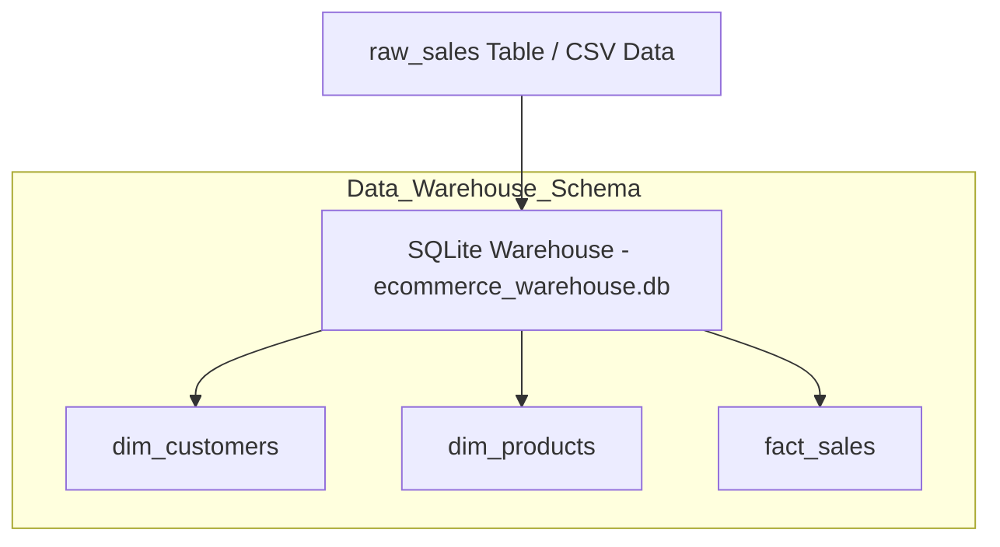

# 🛒 E-Commerce ETL & Data Warehouse Analytics Pipeline

An end-to-end Data Engineering pipeline built with **Python, SQL, and SQLite**. This project extracts raw e-commerce transaction data, ingests it into a temporary staging layer, transforms it into a structured **Star Schema (Fact and Dimension tables) using pure SQL queries**, loads it into a SQLite Data Warehouse, and executes SQL analytical queries to generate business insights.

---

## 📌 Project Overview

In this project, raw sales transaction data is processed and structured into a Data Warehouse model. **SQL queries are executed directly** for data transformation (financial metric calculations) and for analyzing city-wise sales performance.

### Key Highlights:
- **ETL Pipeline:** Extract, Transform, and Load processing using **Python, Pandas, and SQL Queries**.
- **Data Transformations:** Heavy reliance on **SQL Queries (`SELECT DISTINCT`, `ROUND`, math expressions)** for data transformation instead of Pandas functions.
- **Data Modeling:** Structured raw data into a **Star Schema** (Fact and Dimension tables).
- **Financial Calculations:** Calculated `Gross_Amount` and `Net_Sales` accounting for discounts directly via **SQL Expressions**.
- **Data Warehousing:** Stored modeled data into an embedded SQLite database (`ecommerce_warehouse.db`).
- **Analytics:** Executed analytical SQL queries (`JOIN`, `GROUP BY`, `ORDER BY`) to extract revenue performance across different cities.

---

## 🏗️ Data Warehouse Schema (Star Schema)

1. **`dim_customers`**: `Customer_ID`, `Customer_Name`, `City`, `Join_Date`
2. **`dim_products`**: `Product_ID`, `Category`, `Unit_Price`
3. **`fact_sales`**: `Order_ID`, `Order_Date`, `Customer_ID`, `Product_ID`, `Quantity`, `Discount_Percent`, `Gross_Amount`, `Net_Sales`

---

    FactSales --> Analytics[SQL Aggregation & Business Insights]
    DimCust --> Analytics

    
## 📊 Business Insights & Results

| City | Total Orders | Total Revenue |
| :--- | :---: | :---: |
| **Dhaka** | 849 | $670,795.49 |
| **Chittagong** | 358 | $277,858.02 |
| **Sylhet** | 304 | $253,292.99 |
| **Khulna** | 219 | $179,150.88 |
| **Rajshahi** | 178 | $138,730.90 |
| **Barisal** | 92 | $74,788.73 |

---

## 🛠️ Tech Stack

- **Language:** Python 3.x
- **Database / Data Warehouse:** SQLite3
- **Query Engine:** Pure SQL (`SELECT`, `JOIN`, `GROUP BY`, `DISTINCT`, `ROUND`)
- **Libraries:** Pandas, SQLite3
- **Environment:** VS Code (Jupyter Notebook)

